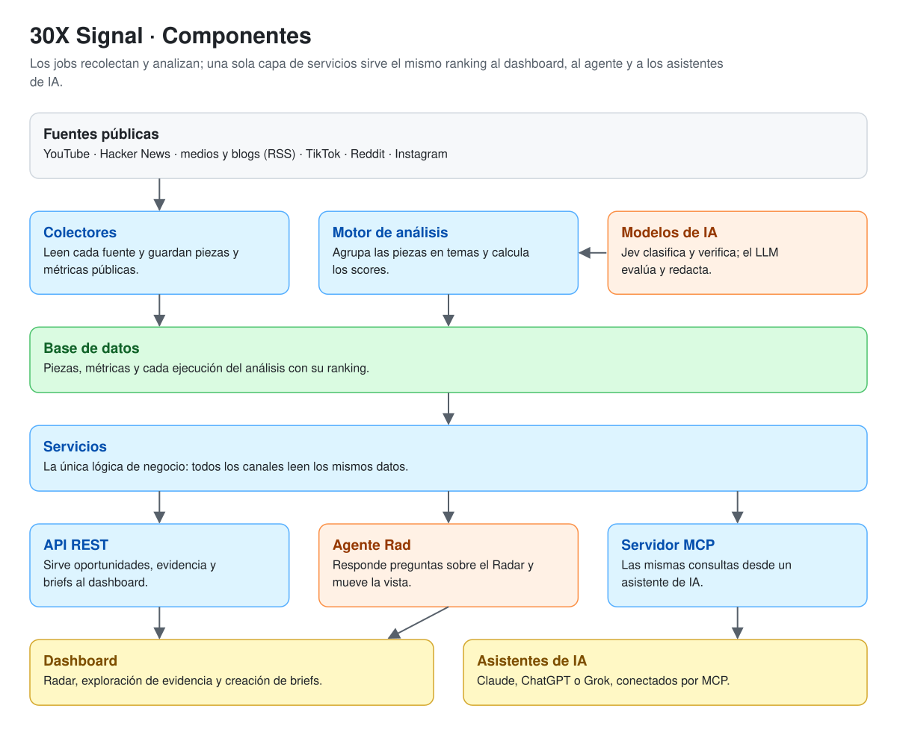
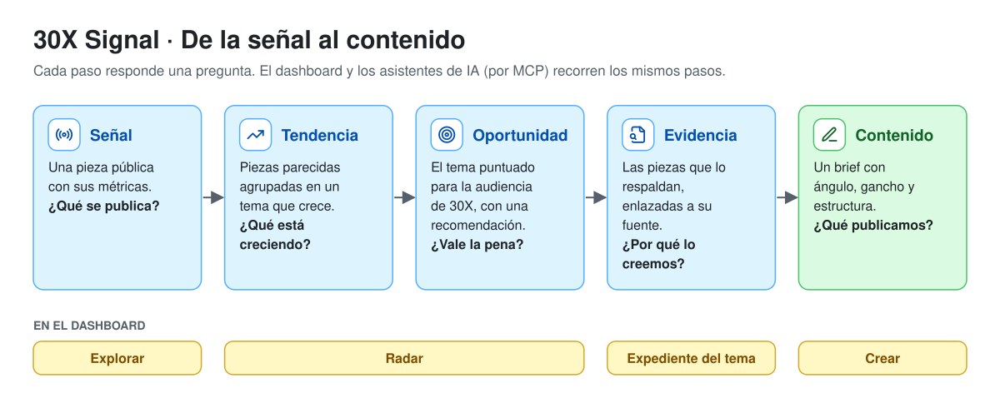

<p align="center">
  <picture>
    <source media="(prefers-color-scheme: dark)" srcset="docs/assets/logo-dark.svg">
    
  </picture>
</p>

<p align="center">
  <strong>Radar de inteligencia editorial sobre IA para ejecutivos y equipos de Latinoamérica.</strong>
</p>

<p align="center">
  <a href="https://signal-pi-black.vercel.app/">Dashboard</a> ·
  <a href="https://content-radar-production-9453.up.railway.app/docs">API</a> ·
  <a href="#conectar-el-mcp">MCP</a> ·
  <a href="docs/architecture.md">Arquitectura</a> ·
  <a href="docs/scoring.md">Algoritmo</a>
</p>

<p align="center">
  <a href="LICENSE"></a>
  
  
  
</p>

---

> **¿Cuáles son los 10 temas de IA que más están creciendo esta semana, por qué funcionan y cómo los adapta 30X para ejecutivos y equipos de Latinoamérica?**

30X Signal responde a esa pregunta, el reto **30X · Media** del Hackathon del 17–18 de octubre de 2026. Convierte señales públicas de Internet en oportunidades editoriales con evidencia enlazada, y se consulta desde un dashboard o desde un asistente de IA (Claude, ChatGPT, Grok) por MCP.

- **Detecta temprano.** Mide velocidad y aceleración, no popularidad: un tema que acelera pesa más que uno que ya es grande.
- **Explica por qué.** Cada oportunidad trae sus piezas de evidencia, la etapa del tema y para quién importa.
- **Piensa en 30X.** Evalúa el encaje con su audiencia y señala los temas que aún no se cubren en Latinoamérica.
- **No inventa.** Los scores los calcula Python; la IA evalúa y redacta, y lo que escribe se verifica contra la evidencia. Si hay 7 temas con datos suficientes, se muestran 7.

## En vivo

| | |
|---|---|
| Dashboard | https://signal-pi-black.vercel.app/ |
| API REST y su documentación | https://content-radar-production-9453.up.railway.app/docs |
| Servidor MCP | https://content-radar-production-9453.up.railway.app/mcp |

El dashboard pide iniciar sesión. Las credenciales del usuario demo van en la entrega del reto, no en este repositorio.

## Cómo funciona



Los colectores recogen señales públicas de forma periódica y el motor de análisis las convierte en un ranking de temas. Qué hace cada componente: [docs/architecture.md](docs/architecture.md).

Cada paso del producto responde una pregunta:



## Fuentes

| Fuente | Acceso |
|---|---|
| YouTube | Data API v3 oficial |
| Hacker News | API de Algolia |
| Medios y blogs (tech, negocio, LATAM) | RSS |
| TikTok · Reddit | ScrapeCreators, un proveedor de datos públicos: búsquedas por palabra clave y subreddits |
| Instagram | ScrapeCreators, solo los reels de perfiles elegidos a mano |
| X | twitterapi.io, un proveedor de datos públicos: solo los últimos tweets de perfiles elegidos a mano |
| LinkedIn | **Fuera del MVP.** Sin login no se puede buscar su contenido. Sus referentes entran por sus canales abiertos (YouTube, newsletters, RSS) |

Solo guardamos metadatos, enlaces y métricas públicas, nunca datos personales. Límites de cada fuente: [docs/sources.md](docs/sources.md).

## Cómo se prioriza


- **Velocidad y aceleración, no popularidad.** Piezas nuevas al día en los últimos 3 días frente a los 3 anteriores, ajustadas por volumen. El total de views nunca entra en un score.
- **Outliers.** Piezas que rinden 3× o más sobre la referencia de su canal o fuente. Lo que se deriva de ellas es una hipótesis, no una causa.
- **Etapa del tema** (emerging → saturated), fuentes independientes, saturación, **para quién importa** y **LATAM Opportunity Gap**.
- **Opportunity Score** = 0,30·momentum + 0,25·audience fit + 0,20·fuentes independientes + 0,15·(100 − saturación) + 0,10·accionabilidad. La confianza se muestra aparte, y cada oportunidad trae una recomendación con la regla que la produjo: publicar ya, buscar ángulo, esperar caso o descartar.

Las fórmulas y los umbrales de cada paso: [docs/scoring.md](docs/scoring.md).

## Conectar el MCP

Solo lectura y con datos públicos. Seis tools: oportunidades en tendencia, análisis de una oportunidad, búsqueda de señales, comparación de audience fit, coste de operación y brief editorial.

```bash
claude mcp add --transport http 30x-signal https://content-radar-production-9453.up.railway.app/mcp
```

Otros clientes (Claude web, MCP Inspector): [docs/mcp.md](docs/mcp.md).

## Coste de operación

Cada llamada a una API externa registra su consumo y su coste, con precios de fuente y fecha conocidas ([`data/pricing.yaml`](data/pricing.yaml)). `GET /api/v1/costs` y la tool MCP `get_operating_cost` dan el coste medido y la proyección mensual por separado; la proyección es una estimación. Detalle: [docs/costs.md](docs/costs.md).

## Limitaciones

- La saturación y el LATAM Gap son relativos a las fuentes que monitoreamos, no a todo Internet ni a todo el mercado LATAM.
- El audience fit es una evaluación editorial asistida por IA, no una medición.
- El historial empieza el 17/10: la velocidad de una pieza necesita dos mediciones o más, y sin ellas la evidencia se marca como estimada o preliminar.
- El «por qué funcionó» compara solo el gancho del título de los outliers con el resto del tema.

## Equipo

| | Área |
|---|---|
| **Steven** | Data & Backend: conectores, base de datos, jobs, API y despliegue |
| **Melkin** | AI & Intelligence: clustering, scoring, Jev, LLM y MCP |
| **David** | Product & Frontend: Vue, visualizaciones, UX y demo |

---

## Puesta en marcha

**Requisitos:** Docker · [uv](https://docs.astral.sh/uv/) (instala Python ≥ 3.12 si hace falta) · Node ≥ 20.19 y pnpm 11 (frontend).

### Backend

```bash
docker compose up -d --wait          # Postgres 17 + pgvector en localhost:5433
cp .env.example backend/.env         # completar las claves (tabla de abajo)
cd backend
uv sync                              # todo, incluido torch (grupo ml) para analyze
uv run alembic upgrade head
uv run python -m app.jobs.seed_sources   # carga data/sources.yaml (idempotente; --dry-run para revisar)
uv run python -m app.jobs.collect        # backfill de 14 días; --days 7 para refrescar, --platform youtube para una sola
uv run python -m app.jobs.analyze        # Jev → embeddings → clustering → scores → LLM
uv run uvicorn app.main:app --reload     # http://localhost:8000/health · /docs · /mcp
```

- Sin `YOUTUBE_API_KEY`, `seed_sources` y `collect` se saltan YouTube. Sin `SCRAPECREATORS_API_KEY`, se saltan TikTok, Reddit e Instagram.
- Sin `TYPESAFE_API_KEY`, `LLM_API_KEY` o `LLM_MODEL`, `analyze` corre igual, pero sin filtro de Jev y con el audience fit y el Opportunity Score en `null`.
- La primera ejecución de `analyze` descarga el modelo de embeddings de Hugging Face.
- Solo API y MCP, sin torch: `uv sync --no-group ml` (es lo que instala la imagen de Docker).

Tests y lint:

```bash
cd backend
uv run pytest        # crea y usa radar_test en el mismo servidor (cambiar con TEST_DATABASE_URL)
uv run ruff check . && uv run ruff format .
uv run pyright <archivos>
```

Nueva migración tras cambiar modelos: `uv run alembic revision --autogenerate -m "descripcion"` y `uv run alembic upgrade head`.

### Variables de entorno

Solo en el backend (`backend/.env`; plantilla en [`.env.example`](.env.example)). Ninguna clave va al frontend ni al repo.

| Variable | Para qué | ¿Obligatoria? |
|---|---|---|
| `DATABASE_URL` | Postgres con el driver asyncpg | Sí (por defecto, el Docker local) |
| `YOUTUBE_API_KEY` | Colector de YouTube | Para YouTube |
| `SCRAPECREATORS_API_KEY` | TikTok, Reddit e Instagram (se paga por llamada) | Para esas fuentes |
| `TYPESAFE_API_KEY` · `JEV_MODEL` | Jev: clasificación por pieza (versión fijada, `jev-1.13.0`) | Para `analyze` completo |
| `JEV_VERIFY_CLAIMS` | Jev verifica cada afirmación de «por qué importa»; vacía = `true`, `false` solo para depurar | No |
| `LLM_API_KEY` · `LLM_MODEL` | Clave de Anthropic y modelo (`claude-haiku-5-5`, con precio en `pricing.yaml`) | Para `analyze` completo, briefs y agente |
| `CORS_ALLOWED_ORIGINS` | Orígenes del frontend, separados por coma | En producción |
| `MCP_PUBLIC_URL` | URL pública exacta del MCP; con otro `Host`, responde 421 | En producción |
| `APP_ENV` | `local`, `ci` o `production` | No |
| `AUTH_REQUIRED` · `SUPABASE_URL` | Supabase Auth opcional: con `true`, el agente y los briefs piden token. Con sesión, los briefs se guardan por usuario aunque sea `false` | No |
| `DEMO_RUN_ID` | Ejecución de `analyze` fijada para la demo; vacía = la última correcta | No |
| `BRAVE_API_KEY` | Reservada: Brave aún no tiene colector | No |

Tests: `TEST_DATABASE_URL` (opcional). Frontend: `VITE_API_BASE_URL` y `VITE_USE_FIXTURES` (ver abajo).

### Frontend

```bash
cd frontend
pnpm install
pnpm dev                 # http://localhost:5173 · proxy de /api a http://localhost:8000
```

- **Con datos de ejemplo, sin backend:** `VITE_USE_FIXTURES=true pnpm dev`. Los datos salen de `data/fixtures/opportunities.json` (marcado MOCK), y la cabecera muestra el chip "Datos de ejemplo". Sin el flag, los datos salen solo de la API, y si la API falla se ve el error, nunca los fixtures.
- **API en otro puerto:** `API_DEV_TARGET=http://localhost:8001 pnpm dev`.
- **Tipos de la API (nunca a mano):** con la API levantada, `pnpm gen:api` regenera `src/types/api.ts`. Sin la API, desde un JSON: `OPENAPI_URL=ruta/openapi.json pnpm gen:api`.
- **Antes de un PR:** `pnpm lint && pnpm type-check && pnpm test && pnpm build`.
- **En Vercel:** `frontend/vercel.json` reenvía `/api` a Railway. Para llamar a otra API, se pone su URL en `VITE_API_BASE_URL` (ver `frontend/.env.example`).

## Recolección periódica y despliegue

- **Recolección:** `.github/workflows/collect.yml` corre cada 2 h contra Supabase, con los secrets `DATABASE_URL` (session pooler, puerto 5432), `YOUTUBE_API_KEY` y `SCRAPECREATORS_API_KEY`. ScrapeCreators solo se consulta a las 00 y a las 12 UTC. En local, `scripts/schedule-local.sh install` programa la recolección con launchd (macOS) contra el Docker local.
- **Análisis:** `.github/workflows/analyze.yml` corre después de cada recolección correcta. Necesita además `TYPESAFE_API_KEY` y `LLM_API_KEY`; si falta alguna, no se ejecuta, para no publicar oportunidades sin filtro ni score. Las respuestas de Jev y del LLM se cachean en la DB.
- **API y MCP (Railway):** una sola imagen sin torch (`backend/Dockerfile`, configurada en `railway.json`). Migra al arrancar y usa `/health` como healthcheck. Variables: `DATABASE_URL`, `APP_ENV=production`, `CORS_ALLOWED_ORIGINS`, `MCP_PUBLIC_URL`, `LLM_API_KEY` y `LLM_MODEL` (briefs y agente) y, si se fija, `DEMO_RUN_ID`. Jev solo corre en `analyze`. Railway inyecta `PORT`.
- **DB (Supabase):** activar la extensión `vector` y usar la URL del session pooler con `postgresql+asyncpg://`. Los datos locales se migran con `pg_dump -Fc` / `pg_restore --no-owner --no-acl`, que conserva el historial de snapshots.
- **Imagen en local:** `docker build -f backend/Dockerfile -t radar-api . && docker run -p 8000:8000 --env-file backend/.env radar-api`. Dentro de Docker, la DB local está en `host.docker.internal:5433`.

## Estructura

```
backend/app/
  collectors/    YouTube, HN, RSS, ScrapeCreators → ContentSignal
  intelligence/  embeddings, clustering, velocidad, outliers, lifecycle, ranking, Jev
  editorial/     audience fit, explicaciones y briefs con el LLM (prompts versionados)
  services/      lógica de negocio compartida por la API y el MCP
  api/routes/    FastAPI (delgado)  ·  mcp/  servidor MCP  ·  agent/  agente del Radar
  schemas/ models/ db/ jobs/
frontend/src/    Vue 3 + Vite: Radar, Explorar, expediente del tema y Crear
data/            sources.yaml, pricing.yaml, audiences/, evaluations/, fixtures/ (MOCK)
docs/            brief, fuentes, Jev, MCP
```

## Cómo trabajamos

Una rama corta por tarea (`data/…`, `intel/…`, `fe/…`) y PRs pequeños; `main` siempre desplegable y con los tests en verde. Las decisiones y los contratos viven en [CLAUDE.md](CLAUDE.md).

## Licencia

[MIT](LICENSE) © 2026 Qatro Labs.
