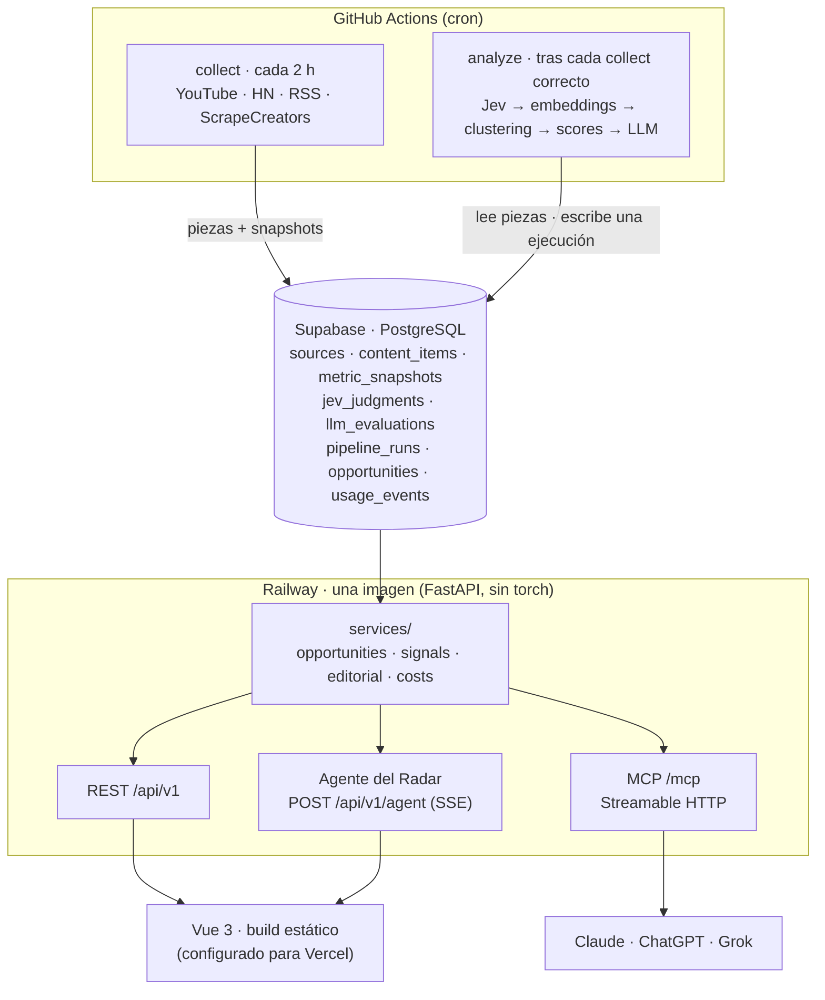

# Arquitectura

> Cómo está montado 30X Signal: componentes, pipeline, dónde corre cada pieza, qué hace cada modelo
> y cómo se protege. Describe el código de `main` en el commit `d6b833b` (18/10/2026). Las decisiones viven en
> [`CLAUDE.md`](../CLAUDE.md) §4; el algoritmo de priorización, en [`scoring.md`](scoring.md); el
> coste medido, en [`costs.md`](costs.md).

## En una frase

Un **monolito modular** en Python: unos jobs recolectan señales públicas y calculan oportunidades,
las guardan en Postgres por ejecución, y una sola capa de servicios las sirve a la vez a la API REST
(para el dashboard en Vue), al servidor MCP (para asistentes de IA) y al agente del Radar. Ni el
frontend ni el MCP calculan nada: leen lo que ya calculó `analyze`.

## Diagrama

## Componentes

| Componente | Qué hace | Código |
|---|---|---|
| **Collectors** | Leen cada fuente activa y devuelven `ContentSignal` normalizado. No escriben en la DB | `backend/app/collectors/` (`youtube.py`, `hackernews.py`, `rss.py`, `scrapecreators.py`) |
| **Persistencia de señales** | Upsert de piezas (dedupe por `platform` + `external_id`) y un snapshot de métricas por observación | `backend/app/services/signals.py` |
| **`collect`** | Recorre las fuentes activas, guarda piezas y snapshots y registra el consumo de cada API | `backend/app/jobs/collect.py` |
| **`analyze`** | Calcula las oportunidades y las guarda como una ejecución nueva | `backend/app/jobs/analyze.py` |
| **Intelligence** | Funciones puras: embeddings, clustering, velocidad, outliers, etapa, scores, recomendación | `backend/app/intelligence/` |
| **Editorial** | Entradas y salidas del LLM (audience fit, «por qué importa», briefs) y prompts versionados | `backend/app/editorial/` |
| **Services** | La única lógica de negocio: la usan la API, el MCP y el agente | `backend/app/services/` |
| **API REST** | Rutas delgadas bajo `/api/v1`: oportunidades (listado, detalle, evidencia, timeline y lecturas en bloque `/evidence` y `/timelines`), fuentes, coste, briefs y agente | `backend/app/api/routes/`, `backend/app/main.py:38` |
| **Servidor MCP** | Las mismas consultas desde un asistente de IA. Detalle: [`mcp.md`](mcp.md) | `backend/app/mcp/` |
| **Agente del Radar** | Responde preguntas del usuario sobre la ejecución servida y propone cambios de vista | `backend/app/agent/`, `backend/app/api/routes/agent.py` |
| **Dashboard** | Vue 3 + TypeScript. Habla solo con la API REST | `frontend/` |

Las fuentes activas están en [`data/sources.yaml`](../data/sources.yaml) y su acceso, coste y
límites, en [`sources.md`](sources.md). Brave Search figura en el plan pero no tiene colector.

## Pipeline

### 1. `collect` (cada 2 h)

`.github/workflows/collect.yml` corre en el minuto 15 de cada dos horas contra Supabase:

1. Migra la DB y carga `data/sources.yaml` (`seed_sources`, idempotente).
2. Lee los últimos 7 días de cada fuente activa (14 en el backfill inicial). Las fuentes marcadas
   con `ai_filter: true` (55 en `sources.yaml`) descartan en el colector las piezas sin términos de
   IA (`backend/app/collectors/text.py:25`).
3. Guarda cada pieza una vez y un snapshot nuevo de sus métricas. Cada ejecución es una
   observación más: así se construye la velocidad de una pieza.
4. ScrapeCreators (TikTok, Reddit, Instagram) cobra por llamada: solo se consulta en las ejecuciones
   de las 00 y las 12 UTC y en las manuales.

Un error en una fuente no para las demás; queda en `pipeline_runs.stats`.

### 2. `analyze` (después de cada `collect` correcto)

`.github/workflows/analyze.yml` se dispara cuando `collect` termina bien. Si falta `DATABASE_URL`,
`TYPESAFE_API_KEY` o `LLM_API_KEY`, no se ejecuta: una ejecución sin filtro o sin score pasaría a
ser la servida. Un `pg_try_advisory_lock` impide que corran dos a la vez
(`backend/app/jobs/analyze.py:50`).

| Paso | Qué pasa | Quién |
|---|---|---|
| 1. Cargar | Piezas de fuentes activas publicadas en los últimos 14 días, con sus snapshots hasta `as_of` | Python (`backend/app/services/opportunities.py:55`) |
| 2. Clasificar | Una llamada a Jev por pieza nueva con la batería `piece.v3`; lo ya clasificado sale de la caché `jev_judgments` | **Jev** |
| 3. Filtrar | Sale una pieza solo si Jev dice con seguridad que ni el tema ni el título son de IA | Python |
| 4. Agrupar | Embeddings multilingües (ES y EN en el mismo espacio) y clustering aglomerativo por coseno | sentence-transformers + scikit-learn |
| 5. Calcular | Notas replicadas dentro de cada tema (enlace compartido, Jev `pair.v1` en la franja dudosa, regla de respaldo); después velocidad, aceleración, outliers, saturación, fuentes independientes, etapa, confianza, audience mix, LATAM gap | Python y **Jev** (pares) |
| 6. Evaluar | Audience fit por tema: 6 criterios con justificación, citas y nivel 0–5, y el nombre del tema. Caché en `llm_evaluations` | **LLM** |
| 7. Puntuar | Opportunity Score, recomendación y orden | Python |
| 8. Explicar | «Por qué importa» y limitaciones, después del fit y de la recomendación | **LLM**, comprobado en Python |
| 9. Guardar | Una fila por oportunidad en `opportunities`, con `payload`, `evidence` y `timeline` validados contra el contrato | Python |

Sin clave de Jev, o si Jev falla en una pieza, la pieza queda sin clasificar y el job sigue. Si el
LLM falla en un tema, su audience fit queda en `null` con una limitación (CLAUDE.md §2, regla 3).
Los umbrales y fórmulas de los pasos 3, 5 y 7 están en [`scoring.md`](scoring.md).

## Dónde corre cada cosa

| Pieza | Dónde | Notas |
|---|---|---|
| `collect` y `analyze` | GitHub Actions | Secrets solo en el `env` del paso que los usa; acciones fijadas por SHA. `analyze` instala el grupo `ml` (torch CPU) y cachea el modelo de embeddings |
| API REST + MCP + agente | Railway, una sola imagen (`backend/Dockerfile`, sin torch) | Migra al arrancar; healthcheck en `/health`. El MCP se monta en la misma app ASGI (`backend/app/main.py:61`) |
| Base de datos | Supabase (PostgreSQL + pgvector), session pooler | El transaction pooler rompería el advisory lock |
| Dashboard | Build estático de Vite, configurado para Vercel (`frontend/vercel.json`) | Solo llama a la API REST |

La puesta en marcha y el despliegue paso a paso están en el [`README`](../README.md).

## Qué hace cada modelo

| Modelo | Hace | No hace | Comprobación |
|---|---|---|---|
| `paraphrase-multilingual-MiniLM-L12-v2` | Agrupa piezas en temas aunque estén en otro idioma | Puntuar | Clusters con un mínimo de 5 piezas; los amplios y poco cohesionados se parten una vez |
| **Jev** (`jev-1.13.0`, TypeSafe) | Juicios atómicos por pieza: ¿trata de IA?, formato, gancho, lanzamiento, inyección y pistas para el LLM | Evaluar un tema completo ni redactar | Probabilidades convertidas en decisiones con umbrales en Python; lo incierto se queda como incierto. Detalle: [`jev.md`](jev.md) |
| **Python** | Todos los scores, la etapa, la recomendación y el orden | — | Funciones puras con tests (CLAUDE.md §11) |
| **LLM** (`claude-haiku-5-5`, SDK oficial de Anthropic) | Niveles 0–5 de la rúbrica de audience fit con justificación, nombre del tema, «por qué importa», briefs y el agente | Calcular scores | Salida estructurada validada con Pydantic; se descarta si `stop_reason` no es `end_turn`. Python quita las citas a piezas que no recibió y las afirmaciones con cifras que no están en los datos |

Hoy la comprobación del texto del LLM la hace Python (cita válida y cifras observadas). La
verificación de cada afirmación con Jev que describe CLAUDE.md §7 no está implementada (ver
[`scoring.md`](scoring.md), "Diferencias con CLAUDE.md").

## Qué ejecución se sirve

Cada `analyze` correcto es una ejecución con su propio ranking; los clusters cambian entre
ejecuciones. La API, el MCP y el agente leen siempre la misma, elegida en
`backend/app/services/opportunities.py:198`:

- Con `DEMO_RUN_ID` fijado en Railway, esa ejecución. Si no existe o no terminó bien, **no se sirve
  nada**: una demo fijada a una ejecución inexistente tiene que notarse.
- Sin `DEMO_RUN_ID`, la última ejecución correcta de `analyze`.

El listado y el detalle salen de la misma ejecución, así que los ids y los scores coinciden. La API
solo calcula el periodo `7d` (ventanas de 3 + 3 días): acepta `period` en la URL, pero la respuesta
dice el periodo real.

## Seguridad

| Riesgo | Cómo se cubre |
|---|---|
| Datos personales | Solo metadatos, enlaces y métricas públicas; nunca el autor de Reddit (CLAUDE.md §2, regla 1) |
| Prompt injection en texto de Internet | El texto externo va solo en el mensaje del usuario, escapado y dentro de bloques `<evidence>` (`backend/app/editorial/audience.py:185`). El system prompt solo lleva texto nuestro. Jev marca cada pieza con la pregunta `injection`: una pieza con probabilidad > 0,5, o sin respuesta, no se envía al LLM en el audience fit, «por qué importa» ni los briefs (`backend/app/intelligence/jev.py:281`). El agente del Radar sí lee los títulos de la evidencia servida; a él lo protegen el saneado, los delimitadores y el canario (fila de abajo). En Jev, el texto va en `state` y nuestras instrucciones en las preguntas |
| Salida del LLM no fiable | Pydantic, `stop_reason`, citas solo a piezas enviadas, cifras solo observadas (`backend/app/intelligence/explanation.py:57`, `backend/app/intelligence/briefs.py`) |
| Agente del Radar | Ámbito cerrado con `decline`; solo lee la ejecución servida y sus acciones solo cambian la vista. Máx. 8 pasos (`backend/app/agent/limits.py:11`), 45 s por pregunta (`backend/app/agent/runner.py:57`), 4 preguntas a la vez (`backend/app/api/routes/agent.py:41`), 20 por IP y hora y 300 al día (`backend/app/agent/limits.py:15`). Entradas y salidas saneadas: se quitan caracteres invisibles, `<` y `>` externos se cambian por sus formas de ancho completo y un canario detecta si el modelo filtra el prompt (`backend/app/agent/sanitize.py`) |
| Coste de las llamadas públicas al LLM | Briefs por REST: 20 por IP y hora, 300 al día y 4 a la vez (`backend/app/api/routes/editorial.py:33`). Briefs por MCP: 20 por hora y 100 al día compartidos y 2 a la vez (`backend/app/mcp/server.py:35`) |
| MCP | Sin SQL arbitrario ni acceso a archivos; solo lee servicios. Todas las tools son de solo lectura salvo `generate_editorial_brief`, que escribe en la caché de briefs y en `usage_events` (`backend/app/mcp/server.py:39`). Acepta solo el `Host` de `MCP_PUBLIC_URL` o uno local (protección contra DNS rebinding). Sin autenticación: solo expone datos públicos ([`mcp.md`](mcp.md)) |
| Secretos | Solo en el backend y en los secrets de Actions; `backend/.env` está en `.gitignore`. Los logs de Jev y del LLM no llevan texto de la pieza |

## Coste de operación

Cada llamada externa (YouTube, HN, RSS, ScrapeCreators, Jev, LLM) registra su consumo en
`usage_events`, con el coste calculado en ese momento con [`data/pricing.yaml`](../data/pricing.yaml).
`GET /api/v1/costs` y la tool MCP `get_operating_cost` devuelven el coste medido y una proyección
mensual por separado. Las cifras medidas y cómo leerlas: [`costs.md`](costs.md).

## Documentos relacionados

- [`scoring.md`](scoring.md): el algoritmo de priorización, con cada constante.
- [`costs.md`](costs.md): coste de operación medido.
- [`sources.md`](sources.md): fuentes, términos y límites.
- [`jev.md`](jev.md): la batería de Jev, umbrales y validación.
- [`mcp.md`](mcp.md): tools MCP y cómo conectarse.
- [`brief.md`](brief.md): el reto y qué podemos afirmar con los datos.
