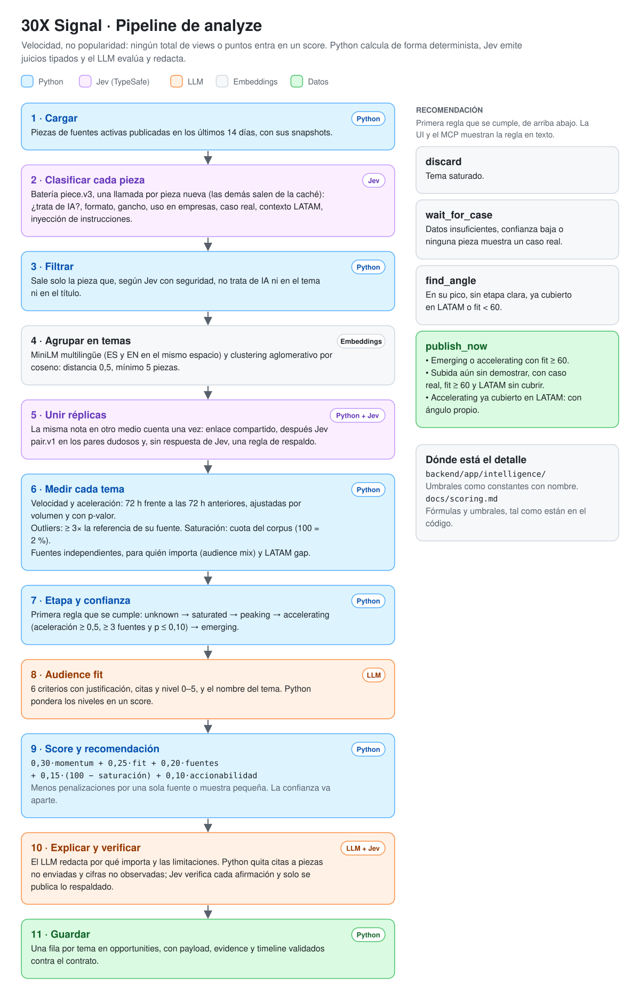

# Algoritmo de priorización

> Cómo `analyze` convierte piezas en oportunidades ordenadas: qué se mide, con qué umbrales y en qué
> orden. Describe el código de `main` en el commit `c7380c9` (18/10/2026); cada constante lleva su `ruta:línea`. Si el
> código y [`CLAUDE.md`](../CLAUDE.md) §7 no coinciden, aquí manda el código y la diferencia se
> anota al final. La arquitectura está en [`architecture.md`](architecture.md) y la batería de Jev,
> en [`jev.md`](jev.md).



## Principios

- **Velocidad, no popularidad.** Ningún total de views, likes o puntos entra en un score. Solo
  tasas, percentiles entre temas y ratios dentro de cada fuente.
- **Python calcula y el LLM evalúa.** Los scores son deterministas: la misma entrada con el mismo
  `as_of` da el mismo resultado. El LLM solo pone niveles 0–5 de una rúbrica (CLAUDE.md §2, regla 4).
- **Lo ausente es `null`, nunca 0.** Sin audience fit no hay Opportunity Score; sin referencia no
  hay outlier ratio.

## Recorrido

```
piezas de 14 días → filtro de Jev → embeddings → clusters → temas activos
  → velocidad y aceleración · outliers · saturación · fuentes independientes
  → etapa · growth_status · confianza · momentum · audience mix · LATAM gap
  → audience fit (LLM) → Opportunity Score → recomendación → orden
```

## 1. Corpus

| Qué | Valor | Dónde |
|---|---|---|
| Ventana de piezas | Publicadas en los últimos 14 días hasta `as_of`, de fuentes activas | `backend/app/services/opportunities.py:38` |
| Inicio del monitoreo ("Datos desde" y texto de las limitaciones) | La primera observación guardada (`min(content_items.first_observed_at)`; hoy, 17/10, 02:48 UTC) | `backend/app/services/opportunities.py:210` |
| Periodo servido | Solo `7d` (ventanas de 3 + 3 días) | `backend/app/services/opportunities.py:40` |

Antes de llegar aquí, las fuentes con `ai_filter: true` ya descartaron en el colector las piezas sin
términos de IA (`backend/app/collectors/text.py:25`).

## 2. Filtro de Jev

Cada pieza pasa por la batería `piece.v3` (`backend/app/intelligence/jev.py:29`). Python convierte
las probabilidades en decisiones:

| Tipo | Regla | Dónde |
|---|---|---|
| `noul` (sí/no) | ≥ 0,7 es sí; ≤ 0,3 es no; en medio, incierto | `backend/app/intelligence/jev.py:50`, `:51` |
| `choice` (formato, gancho) | Probabilidad máxima ≥ 0,6 **y** la misma respuesta con las opciones en orden inverso (`_rev`); si no, incierto | `backend/app/intelligence/jev.py:49`, `:245` |
| Inyección | Probabilidad > 0,5, o sin respuesta: la pieza no se envía al LLM en el audience fit, «por qué importa» ni los briefs (sí cuenta en los scores) | `backend/app/intelligence/jev.py:53`, `:283` |

**Qué sale del corpus:** solo las piezas en las que Jev dice con seguridad "no" a `about_ai` **y** a
`ai_in_title`. Lo incierto o sin clasificar se queda, para no perder temas por un fallo de Jev
(`backend/app/intelligence/jev.py:291`).

**Qué recibe el LLM como pista:** los conteos de `business_use`, `business_case`, `dev_audience`,
`tech_jargon`, `latam_context` y `launch` del tema ("8 de 20 piezas clasificadas…, 3 inciertas") y
los formatos (`backend/app/editorial/audience.py:37`). El `state` de Jev nunca lleva el segmento ni la
región de la fuente (`backend/app/intelligence/jev.py:158`).

## 3. Temas

| Qué | Valor | Dónde |
|---|---|---|
| Modelo de embeddings | `paraphrase-multilingual-MiniLM-L12-v2`, título + 300 caracteres de descripción | `backend/app/intelligence/embeddings.py:8`, `:9` |
| Clustering | Aglomerativo, coseno, *average linkage*, umbral de distancia 0,5 | `backend/app/intelligence/clustering.py:8` |
| Tamaño mínimo de un tema | 5 piezas | `backend/app/intelligence/clustering.py:9` |
| Tema amplio | > 25 piezas y similitud media < 0,6: se parte una vez con umbral 0,4. Si no salen subtemas de ≥ 5, se conserva con la limitación "Tema amplio" | `backend/app/intelligence/clustering.py:12`–`14` |
| Tema activo | ≥ 3 piezas en las dos últimas ventanas (6 días); si no, se descarta | `backend/app/intelligence/opportunities.py:69` |
| Id estable | `opp_<id de la pieza más antigua del cluster>` | `backend/app/intelligence/opportunities.py:162` |

`item_count` es el tamaño del cluster entero (14 días). Solo velocidad, aceleración, saturación y el
timeline usan las ventanas de 3 días.

## 4. Velocidad y aceleración

Ventanas móviles de 72 h desde `as_of`: la actual es `(as_of − 3 d, as_of]` y la anterior, los 3 días
previos (`backend/app/intelligence/velocity.py:17`).

```
velocity     = piezas_actual / 3                                  (piezas/día)
esperado     = piezas_anterior × (corpus_actual / corpus_anterior)
acceleration = (piezas_actual − esperado) / max(esperado, 1)
log_ratio    = log2((piezas_actual + 1) / (esperado + 1))         (lo usa el momentum, §10)
```

- Se calcula sobre conteos de piezas por `published_at`, sin snapshots
  (`backend/app/intelligence/velocity.py:51`–`67`).
- **Ajuste por volumen:** la ventana anterior se escala con el volumen del corpus completo en cada
  ventana. Los feeds RSS solo guardan sus últimas N piezas y los días recientes tienen más volumen en
  todas partes; sin el ajuste, casi todo parecería acelerar. Si el corpus anterior está vacío, la
  escala es 1.
- El suelo `max(esperado, 1)` es de una pieza, no de una pieza al día.
- `velocity` no se pondera por fuentes independientes: es el conteo bruto entre 3.

**¿La subida es real o azar?** Con pocas piezas, pasar de 1 a 2 ya es +100 %. Por eso la
aceleración lleva un p-valor (`backend/app/intelligence/velocity.py:76`): test exacto de razón de
tasas de Poisson. Condicionado a `actual + anterior` notas del tema, el conteo actual es binomial
con `p0 = corpus_actual / (corpus_actual + corpus_anterior)`, es decir, lo esperable si el tema
creciera al mismo ritmo que el corpus. El p-valor es la cola superior `P(X ≥ actual)`. Se calcula
sobre **notas originales** (sin réplicas, §7), en el tema y en el corpus: una nota copiada en tres
medios no es evidencia de aceleración (`backend/app/intelligence/opportunities.py:189`–`183`).
Vale 1 sin notas o con el corpus vacío en alguna ventana. Lo usa la etapa (§8).

**Velocidad de una pieza** (para la evidencia): `Δmétrica / Δhoras` entre su primer y su último
snapshot con valor; `null` con menos de dos (`backend/app/intelligence/velocity.py:96`). Métrica:
views en YouTube, TikTok e Instagram; puntos en HN y Reddit; RSS no tiene
(`backend/app/intelligence/evidence.py:33`).

## 5. Outliers

`outlier_ratio = rendimiento de la pieza / cuantil de su referencia`
(`backend/app/intelligence/outliers.py:52`).

| Qué | Valor | Dónde |
|---|---|---|
| Rendimiento | Views por día de vida (mínimo 1 día) en YouTube, TikTok e Instagram; puntos brutos en HN y Reddit | `backend/app/intelligence/outliers.py:46`, `backend/app/intelligence/opportunities.py:68` |
| Referencia | Las **otras** piezas de la misma fuente (`source_id`: un canal, un perfil, un feed, una búsqueda de HN o TikTok, un subreddit) entre **todas las cargadas**, también las que el filtro de Jev quita por fuera de tema. Esas solo sirven de referencia: no reciben ratio, no son evidencia y no entran en el clustering | `backend/app/intelligence/opportunities.py:140`, `backend/app/services/opportunities.py:190` |
| Cuantil | Mediana; **p90 en HN y TikTok**, que se leen por búsqueda y mezclan muchos autores. HN: con la mediana, ~4 puntos, un 22 % salía outlier; con el p90, un 3–6 %. TikTok (n = 72, 17/10): con la mediana un 33 %, con el p75 un 17 %, con el p90 un 6 % ([análisis](../data/evaluations/outlier_reference_scrapecreators.md)) | `backend/app/intelligence/outliers.py:21`, `:22`, `:26`, `:42`, `backend/app/intelligence/opportunities.py:158` |
| Tamaño mínimo de la referencia | 5 piezas; con menos, ratio `null` | `backend/app/intelligence/outliers.py:20` |
| Edad mínima para entrar en la referencia | 2 días en YouTube, TikTok e Instagram; 6 h en HN y Reddit. Lo recién publicado sí se puntúa, pero no hunde la referencia | `backend/app/intelligence/outliers.py:33` |
| Referencia 0 | Ratio `null` | `backend/app/intelligence/outliers.py:59` |
| Outlier | ratio ≥ 3 | `backend/app/intelligence/outliers.py:18` |

`outlier_count` cuenta las piezas del tema con ratio ≥ 3 y `top_outlier_ratio` es el máximo, `null`
si ninguna tiene ratio (`backend/app/intelligence/opportunities.py:236`). La evidencia guarda hasta 25
piezas, outliers primero y después las más recientes (`backend/app/intelligence/evidence.py:40`,
`:425`).

## 6. Saturación

```
saturation_score = 100 × min(1, cuota / 0,02)
cuota            = notas del tema en las dos ventanas (6 días) / notas originales del corpus en esas ventanas
```

`backend/app/intelligence/cross_source.py:19`, `:38`; se calcula en
`backend/app/intelligence/opportunities.py:191`. 100 equivale a que el tema reúna el 2 % de todas las
notas originales de 6 días; `saturated` (≥ 75) pide ≥ 1,5 %, `peaking` (≥ 60) ≥ 1,2 % y `emerging`
(< 40) < 0,8 %. Cuenta notas, no copias: una nota republicada en tres medios cuenta una vez (§7).
Sigue siendo "en las fuentes que monitoreamos".

Antes era el percentil del tema frente a los demás temas activos. Con un percentil, un 25 % de los
temas quedaba siempre ≥ 75, hubiera saturación o no, y los temas más grandes en descenso se
descartaban por ser los más grandes de la muestra. El 2 % está calibrado con los runs 33–37, donde
la mayor cuota fue del 1,7–1,9 %: es una constante con nombre y ajustable. En el run 37 los
descartes pasan de 7 a 3 (los de 15 notas) y los `peaking` de 2 a 0; el top 10 comparte 9 de 10 con
el de antes. En los runs 33 y 35, los descartes pasan de 5 a 4.

## 7. Fuentes independientes

- **Clave de independencia:** HN y TikTok, que se leen por búsqueda, cuentan cada uno como un solo
  medio; el resto cuenta por fuente (canal, feed, subreddit, perfil)
  (`backend/app/intelligence/cross_source.py:12`, `:22`).
- `source_count` = número de medios distintos en el tema.
- `cross_source_score = min(100, 20 × (medios − 1) + 15 × (plataformas − 1))`; 0 con un solo medio
  (`backend/app/intelligence/cross_source.py:13`, `:14`, `:28`).
- `evidence_strength = min(100, 4 × piezas) × (0,5 + 0,5 × min(1, medios / 3))`
  (`backend/app/intelligence/ranking.py:39`, `:40`, `:53`). No suma métricas entre plataformas.

**Notas replicadas.** Dos medios que publican la misma nota cuentan como una sola fuente. Dentro de
cada tema, dos piezas de medios distintos son la misma nota si se cumple la primera capa:

| # | Capa | Regla | Constantes |
|---|---|---|---|
| 1 | Enlace compartido | Las dos piezas comparten URL, propia o del artículo que enlazan (p. ej., una story de HN) | `backend/app/intelligence/replicas.py:65` |
| 2 | Jev, batería `pair.v1` | Candidatos con coseno ≥ 0,70 o título idéntico; réplica si `same_story` da el nivel 3 con `confidence` ≥ 0,5. Máx. 250 llamadas nuevas por ejecución; el resto sale de la caché `jev_judgments` | `replicas.py:29`, `:32`, `:33`, `backend/app/services/replicas.py:48` |
| 3 | Respaldo, sin respuesta de Jev | Título idéntico de ≥ 5 palabras o coseno ≥ 0,90 | `replicas.py:30`, `:31` |

Si Jev dice que dos piezas son independientes, la regla de respaldo no las une. Las réplicas se
agrupan en notas (union-find) y la pieza más antigua representa a la nota
(`backend/app/intelligence/replicas.py:197`). Cuentan notas, no piezas, `source_count`, `cross_source_score`,
la saturación (§6) y el tamaño de muestra de la etapa (§8), la confianza y las penalizaciones. La velocidad, los outliers y el `audience_mix` siguen
contando piezas. Cada `Evidence` lleva `replica_of` (la URL del representante) y `replica_count`
(`backend/app/schemas/opportunity.py:94`, `:99`); si alguna réplica salió solo de la regla de
respaldo, `limitations` lo dice.

## 8. Etapa (`lifecycle`)

Primera regla que se cumple, en este orden (`backend/app/intelligence/lifecycle.py:37`). El texto de
la regla queda en `lifecycle_reason`.

| # | Etapa | Regla | Constantes |
|---|---|---|---|
| 1 | `unknown` (datos insuficientes) | < 5 notas (§7) **o** < 2 fuentes independientes | `lifecycle.py:12`, `:33` |
| 2 | `saturated` | saturación ≥ 75 y aceleración < 0 | `lifecycle.py:13` |
| 3 | `peaking` | saturación ≥ 60 y \|aceleración\| < 0,2 | `lifecycle.py:14`, `:15` |
| 4 | `accelerating` | aceleración ≥ 0,5, ≥ 3 fuentes independientes **y p ≤ 0,10** | `lifecycle.py:16`, `:17`, `:22` |
| 5 | `emerging` | aceleración > 0, ≤ 3 fuentes independientes y saturación < 40 (sin puerta de p) | `lifecycle.py:18`, `:19` |
| 6 | `unknown` ("sin demostrar") | Cumple 4 salvo el p-valor y no cumple 5: la subida puede ser azar | `lifecycle.py:83` |
| 7 | `unknown` ("en descenso") | aceleración < 0 sin cumplir las anteriores | `lifecycle.py:89` |
| 8 | `unknown` | Ninguna regla se cumple | `lifecycle.py:96` |

Las rutas son relativas a `backend/app/intelligence/`. Como un tema tiene al menos 5 piezas, en la
práctica la regla 1 salta por tener una sola fuente.

`p` es el p-valor de la aceleración (§4). `accelerating` afirma un crecimiento sostenido, así que
exige que la subida no se explique por azar. `emerging` es temprano por definición y no lleva la
puerta: con tan pocas notas, exigirla dejaría fuera casi toda señal temprana. Su razón
incluye el p-valor y, si pasa de 0,10, avisa: "Señal temprana: con tan pocas piezas, la subida aún
puede ser azar" (`lifecycle.py:103`). `saturated` y `peaking` tampoco llevan puerta. Un tema que
falla `accelerating` solo por el p-valor puede quedar `emerging` si cumple esa regla; si no, queda
`unknown` "sin demostrar". El umbral es por tema, sin corregir por comparaciones múltiples (ver
Limitaciones). Un `unknown` de la regla 6 tiene datos: si no lo frenan antes las reglas de
`wait_for_case` (confianza baja o ningún caso real), recomienda `find_angle` (§14).

**`growth_status`** depende de los datos, no de la etapa (`backend/app/intelligence/ranking.py:118`):
`preliminary` con datos insuficientes; `estimated` si la ventana anterior está vacía; `observed` si
la ventana anterior también tiene piezas.

## 9. Confianza

`backend/app/intelligence/ranking.py:129`:

| Confianza | Regla |
|---|---|
| `low` | `preliminary` o < 2 fuentes independientes |
| `high` | `observed`, ≥ 3 fuentes y ≥ 10 piezas |
| `medium` | El resto |

La confianza se muestra aparte del score: un tema puede puntuar alto con evidencia débil.

## 10. Momentum

`backend/app/intelligence/ranking.py:43`:

```
aceleración_norm = 50 + 50 × clamp(log_ratio / 3, −1, 1)
outliers_norm    = min(100, 25 × outlier_count)
momentum_score   = 0,4 × percentil_velocidad + 0,4 × aceleración_norm + 0,2 × outliers_norm
```

| Constante | Valor | Dónde |
|---|---|---|
| `W_VELOCITY` | 0,4 | `backend/app/intelligence/ranking.py:19` |
| `W_ACCELERATION` | 0,4 | `backend/app/intelligence/ranking.py:20` |
| `W_OUTLIERS` | 0,2 | `backend/app/intelligence/ranking.py:21` |
| `LOG_RATIO_CAP` | 3,0 (multiplicar la tasa por 8 o más = máximo) | `backend/app/intelligence/ranking.py:25` |
| `POINTS_PER_OUTLIER` | 25 (4 outliers = 100) | `backend/app/intelligence/ranking.py:26` |

`percentil_velocidad` es el percentil de las piezas de la ventana actual del tema frente a los demás
temas activos (`backend/app/intelligence/cross_source.py:46`, `backend/app/intelligence/opportunities.py:464`).

La aceleración entra como `log_ratio` (§4), no como cambio relativo: con el tope anterior (+100 %),
2 piezas frente a 1 y 70 frente a 5 puntuaban igual. El pseudo-conteo de una pieza por ventana
encoge las razones de conteos pequeños.

## 11. Para quién importa: audience mix y LATAM gap

**`audience_mix`** = proporción del peso de las piezas por segmento de su fuente (`tech`, `business`,
`latam_es`; suma 1) (`backend/app/intelligence/audience_mix.py:21`). El peso de cada pieza es su
outlier ratio acotado entre 0,5 y 3,0, o 1,0 si no tiene ratio
(`backend/app/intelligence/opportunities.py:70`, `:203`). `latam_es` mezcla España y Latinoamérica:
la UI lo rotula "en español".

**`latam_gap`** usa otra proporción: el peso de las piezas cuya fuente tiene `region`
latinoamericana (`latam`, `mx`, `co`, `ar`… 21 códigos). **España no cuenta**
(`backend/app/intelligence/audience_mix.py:15`, `:38`).

| `latam_gap` | Regla | Dónde |
|---|---|---|
| `false` (ya cubierto en la región) | Proporción LATAM ≥ 0,30 | `backend/app/intelligence/audience_mix.py:11` |
| `true` (oportunidad) | Hay conversación de negocio **y** proporción LATAM < 0,10 | `backend/app/intelligence/audience_mix.py:10`, `:49` |
| `null` | El resto: no hay señal suficiente para decidir | `backend/app/intelligence/audience_mix.py:63` |

**"Hay conversación de negocio"** lo decide el contenido, no la fuente
(`backend/app/intelligence/audience_mix.py:49`). Si Jev juzgó alguna pieza del tema
(`business_use`, uso de la IA en organizaciones): al menos 2 piezas con "sí" y al menos el 15 % de
las piezas decididas (las inciertas no cuentan) (`audience_mix.py:8`, `:9`). Sin juicios de Jev,
vale la regla anterior: `audience_mix.business` ≥ 0,15. Solo ~8 % del corpus viene de fuentes de
segmento `business`, así que con el segmento casi ningún tema llegaba a decidir: en la ejecución 37,
33 de 53 temas quedaban en `null` (28 con Jev). La descripción del tema añade cuántas piezas
clasificadas tratan del uso en organizaciones (`backend/app/intelligence/opportunities.py:397`).

## 12. Audience fit (LLM)

El LLM recibe, por tema, hasta 10 piezas seguras (sin las marcadas por inyección), con la
descripción cortada a 500 caracteres, el audience mix y las pistas de Jev
(`backend/app/editorial/audience.py:32`, `:33`, `:147`). El system prompt lleva la rúbrica
(`backend/app/editorial/prompts/audience_fit_rubric.v1.yaml`) y el perfil
[`data/audiences/30x.yaml`](../data/audiences/30x.yaml). Prompt `evaluate_topic.v2`
(`backend/app/editorial/audience.py:27`).

Para cada criterio devuelve primero la justificación y las URLs que cita, y después un nivel entero
de 0 a 5 (`backend/app/editorial/audience.py:47`). Los seis criterios
(`backend/app/schemas/opportunity.py:145`):

| Criterio | Pregunta |
|---|---|
| `business_impact` | Impacto en decisiones empresariales |
| `org_application` | Aplicación real en organizaciones |
| `exec_readability` | Comprensible para directivos no técnicos |
| `latam_relevance` | Relevancia LATAM |
| `pillar_fit` | Encaje con los pilares de 30X |
| `actionable_content` | Convertible en contenido accionable |

Python combina los niveles (`backend/app/intelligence/audience_fit.py:42`):

```
audience_fit_score  = media ponderada de los 6 niveles / 5 × 100
actionability_score = nivel de actionable_content / 5 × 100
```

- **Pesos:** iguales (1,0 cada criterio) hasta que una validación con temas etiquetados justifique
  otros (`backend/app/intelligence/audience_fit.py:19`).
- **Citas:** se quitan las URLs que el LLM no recibió, y se anota cuántas
  (`backend/app/intelligence/audience_fit.py:57`).
- **Bandas** para el texto: bajo < 40 ≤ medio < 60 ≤ alto
  (`backend/app/editorial/explanation.py:40`, `:41`).
- Si el LLM falla o la respuesta no llega entera (`stop_reason` distinto de `end_turn`), el fit queda
  en `null` con una limitación (`backend/app/editorial/evaluator.py:21`, `:67`).

## 13. Opportunity Score

`backend/app/intelligence/ranking.py:60`:

```
opportunity_score = 0,30 × momentum
                  + 0,25 × audience_fit
                  + 0,20 × cross_source
                  + 0,15 × (100 − saturación)
                  + 0,10 × actionability
                  − penalizaciones
acotado a [0, 100]
```

| Constante | Valor | Dónde |
|---|---|---|
| `W_MOMENTUM` | 0,30 | `backend/app/intelligence/ranking.py:29` |
| `W_FIT` | 0,25 | `backend/app/intelligence/ranking.py:30` |
| `W_CROSS` | 0,20 | `backend/app/intelligence/ranking.py:31` |
| `W_FRESHNESS` | 0,15 | `backend/app/intelligence/ranking.py:32` |
| `W_ACTION` | 0,10 | `backend/app/intelligence/ranking.py:33` |
| Penalización `single_source` | −10 si < 2 fuentes independientes | `backend/app/intelligence/ranking.py:34` |
| Penalización `small_sample` | −10 si < 8 piezas | `backend/app/intelligence/ranking.py:35`, `:36` |

Sin audience fit o sin actionability, el score es `null`: no se rellena con un supuesto
(`backend/app/intelligence/ranking.py:71`). El desglose (componentes, pesos y penalizaciones) va en
`score_breakdown`, para que la UI y el MCP lo expliquen.

## 14. Recomendación

Primera regla que se cumple (`backend/app/intelligence/ranking.py:183`); el texto va en
`recommendation_reason`:

| # | Recomendación | Regla |
|---|---|---|
| 1 | `discard` | Etapa `saturated` |
| 2 | `wait_for_case` | Datos insuficientes |
| 3 | `wait_for_case` | Confianza `low` |
| 4 | `wait_for_case` | `org_application` ≤ 1: ninguna pieza muestra una organización real (`backend/app/intelligence/ranking.py:140`) |
| 5 | `find_angle` | Etapa `peaking` |
| 6 | `publish_now` | Etapa `unknown` con datos, aceleración > 0, `latam_gap` `true` o `null`, `org_application` ≥ 2 (`backend/app/intelligence/ranking.py:141`) y audience fit ≥ 60: subida sin demostrar en un tema que LATAM no cubre ya |
| 7 | `find_angle` | Etapa `unknown` con datos (ninguna regla de etapa se cumple, o en descenso) |
| 8 | `publish_now` | `accelerating` (p ≤ 0,10) con `latam_gap = false` y audience fit ≥ 60: publicar con ángulo propio |
| 9 | `find_angle` | `latam_gap = false` en los demás casos: ya hay cobertura en fuentes latinoamericanas |
| 10 | `find_angle` | Sin audience fit |
| 11 | `publish_now` | Llega aquí (`emerging` o `accelerating`) con audience fit ≥ 60 (`backend/app/intelligence/ranking.py:38`) |
| 12 | `find_angle` | Audience fit < 60 |

Un fit bajo no descarta: da `find_angle` y la UI muestra la banda.

Las reglas 6 y 8 se decidieron el 18/10 con una evaluación pre-registrada
([`data/evaluations/publish_policy_eval.md`](../data/evaluations/publish_policy_eval.md)):

- **Regla 6.** Publica un tema cuya subida no pasa la puerta de `accelerating` (p > 0,10) o que no
  encaja en ninguna etapa, si el encaje es alto, hay un caso real y LATAM no lo cubre ya
  (`latam_gap` `true`, o `null`: cobertura parcial o sin conversación de negocio medida). Las
  reglas 1–4 excluyen los temas saturados, con confianza baja o sin caso; la aceleración > 0
  excluye los temas en descenso. La razón dice que el crecimiento no está demostrado y, con
  `null`, que la cobertura en LATAM es parcial o no está medida.
- **Regla 8.** Una subida demostrada con encaje alto se publica aunque LATAM ya la cubra: la
  cobertura regional indica demanda de la audiencia, y la razón pide un ángulo propio.
- **Lo que no cambió y por qué.** `org_application` ≤ 1 sigue bloqueando, pero en la práctica no
  decide: en los runs 38, 41 y 43 ningún tema sin caso llega a fit 60 (máximo 53,3), así que el
  bloqueo lo pone el fit. Bajar el fit a 50 metía un tema que el etiquetado ciego rechazó.

Run 43: de 1 a 3 temas `publish_now`, los 3 marcados "sí" por el etiquetado ciego.

## 15. Orden del ranking

`backend/app/intelligence/opportunities.py:506`, aplicado en `analyze` después del audience fit
(`backend/app/jobs/analyze.py:82`). De mayor a menor:

1. Temas con Opportunity Score antes que los que no lo tienen.
2. Dentro de cada grupo, los que no son `discard` antes que los `discard`.
3. `opportunity_score`.
4. `momentum_score`, y después `acceleration`, para desempatar.

El orden queda guardado en la ejecución (`rank`) y la API y el MCP lo sirven tal cual.

## Limitaciones

Lo que estos números **no** dicen (CLAUDE.md §2, regla 3; [`brief.md`](brief.md) §7):

- **No miden la audiencia real.** El audience fit es una evaluación editorial asistida por IA contra
  el perfil de 30X, no un dato de comportamiento. Los pesos iguales de los criterios no están
  validados.
- **Todo es relativo a la muestra.** Saturación, percentil de velocidad y LATAM gap comparan con las
  fuentes que monitoreamos (las de `data/sources.yaml`), no con Internet ni con el mercado
  LATAM. Un tema saturado aquí puede no estarlo fuera, y al revés. La escala de la saturación
  (100 = 2 % de las notas) está calibrada con los runs 33–37.
- **"Esperar caso" se decide con títulos y descripciones.** El LLM y Jev no leen los artículos. Se
  comprobó leyendo los artículos completos de los 5 temas "sin caso" con mejor score del run 37
  (criterio fijado antes de leer: la regla sería demasiado estricta si 2 o más tuvieran una
  organización que no es un proveedor de IA aplicándola con resultados). Resultado: 0 de 5; 2
  confirmados en todas sus piezas, 2 sin caso en lo que se pudo leer y 1 sin artículo legible
  (varios medios bloquean la lectura automática). La regla se mantiene; su texto dice lo que mide
  ([`data/evaluations/analytics_audit.md`](../data/evaluations/analytics_audit.md)).
- **Poco historial.** El monitoreo con snapshots empezó el 16–17/10. La aceleración compara dos
  ventanas de 3 días, lo que casi siempre es parte del backfill, no historial observado en vivo. La
  velocidad de una pieza necesita dos snapshots, y muchas solo tienen unas horas de historial.
- **El p-valor de la aceleración es por tema.** Con ~50 temas y p ≤ 0,10, cabe esperar hasta ~5
  `accelerating` por azar aunque ningún tema creciera de verdad. Corregir por
  comparaciones múltiples (Benjamini–Hochberg) no deja pasar ninguno con 3 días de datos: en la
  ejecución 37 el mejor p era ≈ 0,02 frente a un primer umbral de ≈ 0,002. La etapa es una señal
  para priorizar, no una prueba.
- **No es causalidad.** Un outlier dice que una pieza rindió más que su referencia, no por qué. El
  "por qué funcionó" (`outlier_hooks`) compara solo el gancho del título entre outliers y el resto
  del tema: es una hipótesis con muestra pequeña, y con pocos outliers casi todo sale anecdótico.
- **Las métricas son las de la fuente.** RSS no tiene métricas, así que no da outliers; HN y Reddit
  se comparan en puntos brutos, sin ajustar por edad.
- **La detección de réplicas no es completa.** Solo compara piezas del mismo tema, y las que salen
  de la regla de respaldo (título o coseno) no las verificó Jev; `limitations` lo indica.
- **Los clusters cambian entre ejecuciones.** Una oportunidad puede cambiar de id, partirse o
  desaparecer en la siguiente ejecución. Por eso la demo se fija con `DEMO_RUN_ID`.
- **Jev se equivoca.** De las 36 piezas que el filtro de fuera de tema quitó en la validación con
  200 piezas, 9 eran buenas, según evaluadores LLM a ciegas, no humanos (`data/evaluations/jev_piece_v3_eval.md`).
- **Las métricas de TikTok e Instagram** solo se vuelven a medir si la pieza vuelve a salir en la
  búsqueda o entre los últimos reels del perfil ([`sources.md`](sources.md)).

## Diferencias con CLAUDE.md

El código de `main` difiere de lo que describe CLAUDE.md en estos puntos. Este documento sigue al
código. CLAUDE.md §7 recoge desde el 18/10 la puerta de p-valor de la etapa, el log-ratio del
momentum y la regla de negocio del LATAM gap; el resto de CLAUDE.md no se ha tocado.

| # | Tema | CLAUDE.md dice | El código hace |
|---|---|---|---|
| 1 | Velocidad del tema (§7) | Piezas nuevas por día "ponderadas por fuentes independientes" | Conteo bruto entre 3 días, sin ponderar (`backend/app/intelligence/velocity.py:62`) |
| 2 | Referencia de YouTube (§7) | Mediana de los últimos 20 vídeos del mismo canal (`playlistItems` + `videos.list`) | Mediana de las otras piezas del mismo canal cargadas en los 14 días del corpus (incluidas las que Jev quita), con ≥ 2 días de edad y un mínimo de 5 (`backend/app/intelligence/opportunities.py:140`). No son necesariamente los últimos 20 vídeos |
| 3 | "Destacado" ≥ 2× (§7) | Banda de piezas destacadas | `NOTABLE_RATIO = 2.0` existe pero no se usa en ningún sitio (`backend/app/intelligence/outliers.py:19`) |
| 4 | Ubicación de los módulos (§7, §10) | `intelligence/momentum.py`, `saturation.py`, `relevance.py` | Momentum, score y recomendación en `ranking.py`; saturación y fuentes independientes en `cross_source.py`; audience fit en `audience_fit.py`. No hay `momentum.py`, `saturation.py` ni `relevance.py` |
| 5 | Saturación (§7) | Volumen de contenido similar en la ventana reciente | Cuota del tema en las notas originales del corpus de 6 días; 100 = 2 % (`backend/app/intelligence/cross_source.py:38`). Los umbrales de etapa (75, 60, 40) se aplican a esa escala |
| 6 | Notas replicadas (§7) | Regla provisional de similitud coseno ≥ umbral y fuente distinta; después, la batería de pares de Jev | Implementado por capas: enlace compartido, Jev `pair.v1` (coseno ≥ 0,70, máx. 250 llamadas) y respaldo (título idéntico de ≥ 5 palabras o coseno ≥ 0,90) (`backend/app/intelligence/replicas.py:29`, `backend/app/services/replicas.py:48`). Solo dentro de cada tema. Fuentes, saturación y etapa cuentan notas; velocidad, outliers y `audience_mix` siguen contando piezas |
| 7 | Penalizaciones (§7) | Datos pobres, fuentes duplicadas, muestra pequeña | Solo `single_source` (−10) y `small_sample` (−10) (`backend/app/intelligence/ranking.py:34`, `:35`) |
| 8 | Etapa (§7) | Cinco reglas | Añade un `unknown` "sin demostrar" cuando `accelerating` solo falla por el p-valor (`backend/app/intelligence/lifecycle.py:83`) y otro "en descenso" con aceleración < 0 (`backend/app/intelligence/lifecycle.py:89`). Con clusters de ≥ 5 piezas, "menos de 5 piezas" no llega a darse |
| 9 | Audience mix (§7) | Ponderado por el engagement normalizado | Ponderado por el outlier ratio acotado a [0,5, 3,0], 1,0 sin ratio (`backend/app/intelligence/opportunities.py:203`) |
| 10 | LATAM gap ([`brief.md`](brief.md) §7) | Se sostiene "cuando ambos grupos de fuentes tienen cobertura suficiente" | No comprueba la cobertura del grupo A (global); solo la proporción LATAM y la conversación de negocio (`backend/app/intelligence/audience_mix.py:63`) |
| 11 | Verificación de afirmaciones (§7) | Jev verifica cada afirmación del LLM; se publica con `confidence` ≥ 0,6 | Implementada y **encendida por defecto** (`JEV_VERIFY_CLAIMS=true`) desde que pasó su validación pre-registrada con el prompt `explain_opportunity.v2`, `claim.v2` y umbral 0,6: conserva 33/35 respaldadas, filtra 9/15 negativas (justo el mínimo) y la posición 2 de «por qué importa» sigue en 49 de 53 temas ([`jev_claim_adoption_eval.md`](../data/evaluations/jev_claim_adoption_eval.md)). Python exige antes que cada afirmación cite una pieza enviada y que sus cifras estén en los datos (`backend/app/intelligence/explanation.py:57`); después, Jev responde `claim.v2` contra las piezas citadas y los datos medidos (`backend/app/services/verification.py`): solo se publica lo que respalda, y una afirmación sin veredicto (sin clave, fallo o fuera del tope de 200 llamadas) tampoco se publica; un tema sin ninguna respaldada conserva la plantilla de datos medidos con una nota. Jev filtra los hechos inventados, pero deja pasar la mayoría de las sobregeneralizaciones. Los briefs siguen sin verificar ([`jev.md`](jev.md) §3) |
| 12 | "Por qué funcionó" (§7) | Lift de gancho y formato entre outliers y el resto del tema | Solo el gancho, en `outlier_hooks` (`intelligence/why_it_worked.py`), sin hipótesis redactada por el LLM: el asistente del MCP lee la tabla. El formato sigue llegando al LLM solo como conteos |
| 13 | Pistas de Jev (§7) | Incluye "pilar de 30X" | La batería `piece.v3` no tiene pregunta de pilar (pendiente en [`jev.md`](jev.md)) |
| 14 | Fuentes (§2 regla 2, §5) | LinkedIn, Instagram y TikTok fuera del MVP; Brave en P1 | TikTok, Reddit e Instagram entran por ScrapeCreators desde el 17/10 ([`sources.md`](sources.md)). Brave no tiene colector |
| 15 | MCP (§6) | Herramientas de solo lectura | `generate_editorial_brief` escribe en la caché de briefs y en `usage_events` (`backend/app/mcp/server.py:39`) |
